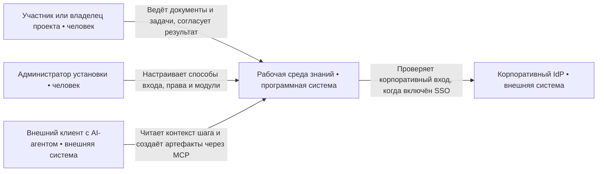
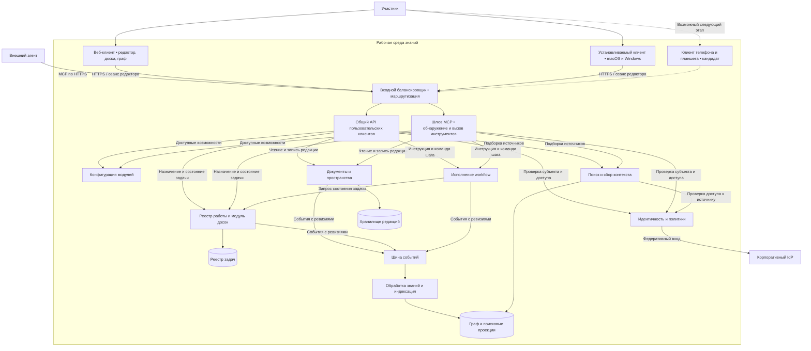

# Устройство платформы
Редакция 0.3, FC-007. Микросервисы, флаги двух уровней и ориентир на крупную организацию задал владелец. Ниже — рабочая модель для обсуждения. Выбор хранилищ, протоколов внутренних команд, оркестратора контейнеров и числа реплик открыт.

## Два уровня C4

Контекст показывает, кто обращается к системе. Вид контейнеров раскрывает исполняемые приложения, сервисы и хранилища для одного сценария. Нотация диаграмм — Mermaid. [Контекст в C4](https://c4model.com/diagrams/system-context), [контейнеры в C4](https://c4model.com/diagrams/container).

### C1. Контекст

[Открыть схему контекста в браузере](http://127.0.0.1:4120/c4-context.svg).

### C2. Контейнеры сквозного сценария

[Открыть схему контейнеров в браузере](http://127.0.0.1:4120/c4-containers.svg).

Граница диаграммы — доступ к материалам, задача и производные знания. Совместное редактирование, загрузка медиа и каталог расширений описаны в [карте сервисов](service-map.md). Реестр владеет состоянием задачи, workflow владеет редакцией процесса и проверкой переходов. Форма интеграции этих двух операций требует отдельного контракта. Авторизацию каждой записи выполняет сервис-владелец. На схеме показана только часть обращений к политикам и флагам.

## Клиентские приложения

| Платформа | Ожидание владельца | Предмет проработки |
|---|---|---|
| Браузер | Требуется | Дерево и редактор страниц, пространственный граф с историей, конструктор процессов |
| macOS и Windows | Требуются скачиваемые приложения | Адрес своей установки, вход и обновление клиента. Стек, упаковка и сроки поставки обсуждаются |
| Телефон и планшет | Кандидаты на следующий этап | Проверить чтение, поиск, согласование и сенсорную навигацию. Состав мобильного редактора и конструктора предстоит выбрать |

Предлагаемый контракт общий для пользовательских клиентов. Сервер проверяет права, версии документов, доступные модули и переходы workflow независимо от типа клиента. Ссылки на страницу, узел или процесс содержат стабильный идентификатор. После входа участник может открыть тот же объект с другого устройства.

Граф воспроизводит доступные пользователю события со временем, идентификатором сущности, ревизией и связью с источником. Положение камеры и скорость воспроизведения относятся к представлению графа. Размер загружаемого подграфа, совместимость версий, подписание сборок, офлайн-режим и синхронизация требуют отдельных решений.

## Переключение возможностей

| Возможность | Что наблюдает пользователь или агент | Предлагаемая проверка |
|---|---|---|
| Корпоративный SSO выключен | Исчезает способ корпоративного входа. Начать новый вход через IdP напрямую тоже нельзя | У администратора и существующих пользователей есть разрешённый альтернативный способ входа. До применения показать, для каких групп пропадёт единственный способ |
| Самостоятельная регистрация выключена | Форма и операция создания собственного аккаунта недоступны. Вход в существующий аккаунт работает | Отдельно решить политику приглашений, автоматического создания аккаунта из IdP и действующих сессий |
| Доски выключены | Навигация и операции модуля скрыты в веб-клиенте и MCP. Прямой вызов получает причину отключения | Сохранить данные. У уже связанного документа сохранить ссылку с состоянием «Модуль выключен». Проверить повторное включение |
| Workflow использует отключаемый модуль | Администратор до изменения видит зависимые процессы и число активных шагов | Предложение для пилота — приостановить затронутые шаги с объяснением и возобновлять их идемпотентно. Независимые процессы продолжаются |

Для первой модели настройка действует на установку. Переопределение для организации или пространства остаётся вопросом к владельцу. Включённый флаг открывает возможность только субъектам с нужными правами RBAC/ABAC. Выключение модуля в рантайме и удаление его реплик из self-hosted поставки — две отдельные операции. Остановка сервиса допустима после проверки зависимостей, фоновых заданий и сохранности данных. Нужно отдельно решить, остаётся ли реестр задач доступен без представления Kanban.

## Нагрузка и изоляция

100 000 — потенциальные сотрудники одной организации. Для расчёта ёмкости нужны доля одновременно активных, операции за минуту, число одновременных агентов, размер контекста, число параллельных редакторов одного документа и объём фоновой перестройки.

| Поток | Что измерить в пилоте | Предложение для архитектуры |
|---|---|---|
| Люди в редакторе и на доске | Активные сеансы, правки/с, размер совместной сессии, задержка сохранения p95 и p99 | Балансировка интерактивного API, маршрутизация совместных сессий по документу, контроль горячих документов |
| MCP | Активные агенты, запросы по типам операций, объём ответа, повторные попытки, длительность поиска | Отдельные пулы и квоты на организацию и субъекта, ограничение параллелизма тяжёлых запросов, идемпотентная запись |
| Обработка знаний | События/с, байты/с, глубина и возраст очереди, время от редакции до появления в выдаче | Масштабирование обработчиков по отставанию, повтор обработки с учётом ревизии, отдельная ёмкость для массовой перестройки |

Для каждого класса операций оцениваем пиковые запросы/с как сумму «активные люди × операций/с на человека» и «активные агенты × операций/с на агента», затем учитываем внутренние обращения и повторы. Испытания — рабочий день, всплеск вызовов MCP при открытых редакторах, массовая перестройка и потеря одной реплики. Проверяем доступность интерактивных записей, целостность ревизий, повторы команд и восстановление очередей. Целевые SLO, запас ёмкости и размер кластера определяются после согласования профиля.

## Вид ArchiMate

[Редактируемая модель для Archi](platform.archimate) показывает, кому служат функции платформы, какие прикладные сервисы их предоставляют и какие компоненты и данные участвуют. В модели есть представления «От роли к данным» и «Клиентские приложения». Архитектор может уточнять модель по мере согласования границ.
