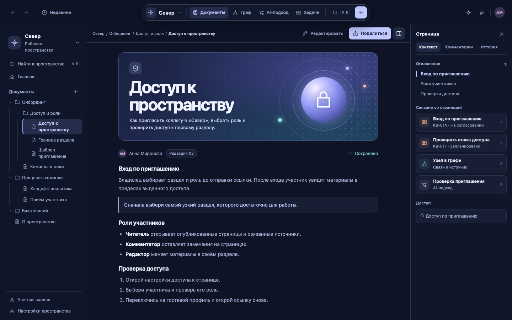

# Север · Дизайн рабочего пространства

Редакция 1 · 18 ноября 2026 года. Основа — одобренный [интерактивный прототип](http://127.0.0.1:4120/design/sever-prototype/#doc/access) и [визуальные принципы графа](../../visual-style.md).

## Оболочка

В широком окне верхнее меню остаётся по центру. Слева от него — назад, вперёд и недавние документы. Справа — тема, настройки пространства и профиль. В центре — текущее пространство, «Документы», «Граф», «AI-подход», «Задачи», поиск и «Создать». Активный раздел выделен и обозначен через `aria-current`.

В документах дерево, текст и инспектор образуют три колонки. Инспектор открывается по действию и содержит оглавление, связанные материалы, доступ, комментарии и редакции. Дерево и инспектор прокручиваются отдельно от текста. Обычная ширина колонки текста — до 730 px. На 1160 px колонки сужаются. До 990 px боковые команды верхнего меню переезжают в компактную навигацию. До 890 px инспектор открывается поверх текста. До 650 px дерево открывается по кнопке, а создание показывает карточки в одну колонку. Закрытие панели возвращает фокус к её кнопке и сохраняет место чтения.

| Сценарий | Что реализовать | Хэндофф |
|---|---|---|
| Документ | Чтение, редактирование, Markdown при вводе, команды, обложка и ревизия | [Редактор](editor.md) |
| Работа вдвоём | Кто читает и редактирует, обмен правками и поведение при разрыве | [Совместная работа](collaboration.md) |
| Первый вход | Вход, регистрация, личное пространство, настройки профиля и приглашения | [Аккаунт и пространства](spaces-and-account.md) |
| Быстрые действия | Карточки создания, история переходов, доступные действия | [Библиотека компонентов](components.md) |

Граф, AI-подход и Kanban используют ту же оболочку. Их видимые сценарии и связи сохранены в [хэндоффе рабочих разделов](work-areas.md). Эти истории находятся дальше в очереди. [Карта контекстов](../../contexts.md)

При добавлении микрофичи обновляем её короткий хэндофф, связываем состояния с компонентом и прикладываем проверку на рабочей версии. Макеты в этом пакете показывают интерфейс. Фактические состояния разработки и приёмки ведутся на [доске](http://127.0.0.1:4117/#backlog).
