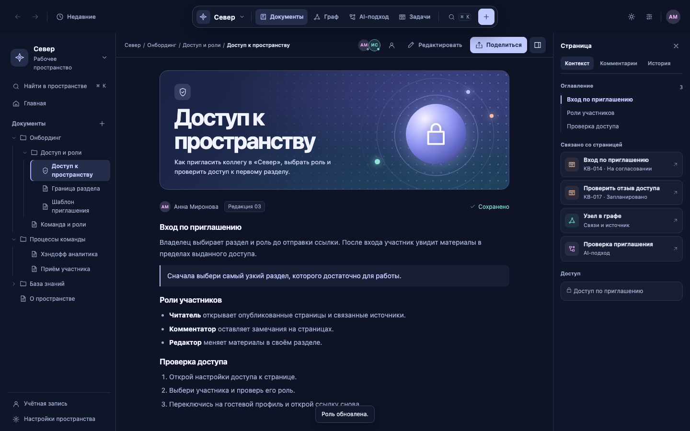

# Документ · Совместная работа

[Дизайн рабочего пространства](README.md) · [KB-COL-07](../../documents/collaboration/kb-col-07.md) · [KB-COL-08](../../documents/collaboration/kb-col-08.md)

## Кто на странице

Группа аватаров находится в строке действий перед «Поделиться». Имя и состояние «читает» или «редактирует» доступны по клавиатуре и экранному диктору. Цвет дополняет текст состояния. В макете видны до четырёх аватаров на широком экране и до двух до 650 px. В продукте дополнительные участники открываются через `+N`. При отсутствии коллег группа не занимает место. При закрытии документа или истечении соединения участник исчезает. При отзыве доступа данные присутствия и документа больше не обновляются на его клиенте.

## Одновременные изменения

Под строкой документа или рядом с «Сохранить» показано состояние записи. Редактор различает «Сохранение», «Сохранено», «Нет соединения» и конфликт, требующий решения. Пока связь отсутствует, локальные изменения доступны для продолжения. После восстановления связи видно, что синхронизировалось и какие изменения ждут решения. При утрате права редактирования форма прекращает отправлять правки и даёт вернуться к чтению при сохранённом праве просмотра.

В прототипе можно открыть вторую вкладку с другим демо-профилем и проверить чтение, редактирование и объединение при сохранении. Для KB-COL-08 рабочая версия должна пройти проверки с двумя независимыми клиентами, включая пересекающиеся изменения, временный разрыв и отзыв прав. Статус и восстановление черновика проверяем на обоих клиентах.
