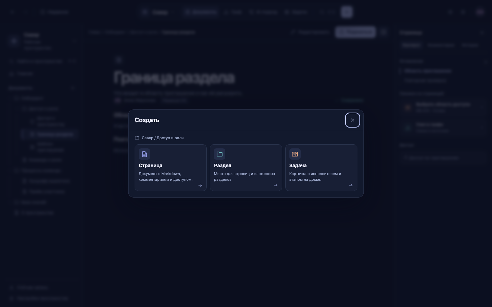

# Север · Библиотека компонентов

Редакция 1 · 18 ноября 2026 года. Размеры и токены сверены с [живым макетом](http://127.0.0.1:4120/design/sever-prototype/#doc/access). Источник значений макета — [workspace.css](../sever-prototype/workspace.css). Граф использует свои оттенки типов узлов. Для новых экранов используем семантические токены.

## Основа

| Назначение | Токен | Тёмная / светлая тема |
|---|---|---|
| Холст, поверхность, приподнятая поверхность | `--background`, `--surface`, `--raised` | `#0E1425` / `#F1F4FA`, `#12192D` / `#FFFFFF`, `#181F35` / `#F8F9FE` |
| Основной, вторичный и приглушённый текст | `--ink`, `--muted`, `--soft` | `#EFF0FF` / `#202943`, `#A1ADCF` / `#4C5B78`, `#8290B4` / `#5C6985` |
| Обычная и усиленная граница | `--line`, `--strong-line` | `#29334C` / `#DFE4F1`, `#37415D` / `#C5CDE1` |
| Действие, текст на акценте, выбранная поверхность | `--accent`, `--accent-ink`, `--selected` | `#C0CAFF` / `#424F9E`, `#212949` / `#FFFFFF`, `#242D49` / `#E7EAFA` |
| Документ, знание, задача, участник | `--document`, `--knowledge`, `--work`, `--agent` | `#A4AEFF` / `#5458A2`, `#7EDBD7` / `#156F70`, `#FDB68B` / `#8C492B`, `#E2B0F2` / `#784986` |

Шрифт интерфейса — Inter с системными запасными вариантами, для кода — системный моноширинный. В макете основа интерфейса 14/21 px, служебные подписи 11–12 px. Радиусы 8 px для поля и кнопки, 11 px для карточки, 16 px для диалога. Контур фокуса 2 px с отступом 3 px. Переходы кнопки 160 мс, карточки 180 мс, открытие диалога 200 мс. При `prefers-reduced-motion` переходы почти мгновенные.

## Базовые компоненты

| Компонент | Состав и варианты | Состояния и доступность | Опора в макете |
|---|---|---|---|
| Кнопка | Текст, иконка или оба. Основная, вторичная, без рамки, опасное действие | Наведение, фокус, нажатие, ожидание, недоступность. У иконки есть доступное имя. Переключатели объявляют состояние | `.btn` |
| Поле формы | Подпись, текст / почта / пароль / список / файл, подсказка и ошибка | Пусто, заполнено, фокус, недоступно, ошибка. Подсказка и ошибка связаны с полем. Вход поддерживает менеджер паролей | `.dialog-field`, `.field`, `.form-status` |
| Строка объекта | Иконка, заголовок, пояснение, действие. Ссылка или кнопка по назначению | Выбор и текущий объект обозначаются текстом, наведение и фокус заметны. Длинное имя читается в доступном названии | `.entity` |
| Аватар и индикатор | Инициалы или изображение. Малый и обычный. Точка статуса опциональна | Имя и состояние читаются текстом. Индикатор рядом с уже видимым именем декоративный | `.avatar`, `.status-dot` |
| Диалог | Название, закрытие, прокручиваемое тело, действия. 520 px или 690 px, с полями 12 px от краёв окна | Фокус у первого действия или поля, ограничен диалогом. Escape закрывает по правилам черновика. После закрытия фокус на триггере | `#panel`, `.dialog-header`, `.dialog-body` |
| Сообщение формы | Ошибка рядом с полем либо итог под группой действий | Сохранение, успех, ошибка, повтор. Динамическое сообщение объявляется без потери ввода | `.form-status`, `#notice` |

## Составные компоненты

| Компонент | Варианты и поведение | Доступность и узкое окно | Связь с разработкой |
|---|---|---|---|
| Верхняя навигация | История и недавние слева, рабочие разделы в центре, тема и профиль справа. Назад и вперёд отключаются на границах | Горячие клавиши у поиска, явные названия кнопок. Компактные команды доступны из меню по пространству | [KB-UI-11](../../documents/interface/kb-ui-11.md) · [KB-FND-08](../../documents/finding/kb-fnd-08.md) |
| Переключатель пространств | Заголовки «Мои» и «Доступные», строки объектов, текущая область и создание | Один набор действий для обеих точек входа. Пустая группа, загружается список, отказ при отзыве членства | [KB-SPC-02](../../documents/spaces/kb-spc-02.md) |
| Карточка выбора действия | Иконка, название типа, короткое последствие, стрелка. Выбор открывает форму с текущим местом | Все карточки доступны клавиатурой, место отмечено перед сеткой. До 650 px одна колонка | [KB-UI-10](../../documents/interface/kb-ui-10.md) |
| Панель документа | Хлебные крошки, группа присутствия, «Редактировать», «Поделиться» и инспектор | Иконки остаются с доступными именами при скрытии подписей. Присутствие читателя и редактора доступно текстом | [Инспектор](../../documents/interface/kb-ui-02.md) · [Совместная работа](collaboration.md) |
| Группа присутствия | Аватары, режим, список переполнения. Пустая группа скрывается | До 4 аватаров на широком экране и до 2 на узком. Кнопка `+N` открывает список, фокус возвращается | [KB-COL-07](../../documents/collaboration/kb-col-07.md) |
| Обложка и галерея | Пустая, шаблон или собственное изображение. Заголовок повторно не рисуется в тексте | Выбор отмечен через `aria-pressed`. Изображение декоративное, заголовок читается поверх стабильной подложки. Ошибка сохраняет прежний вариант | [Обложка](editor.md#выбрать-обложку) |
| Меню команд | Список у курсора, название и результат команды, активный пункт, пустая выдача | Стрелки и Enter работают при сохранённом фокусе редактора. Escape закрывает список. Прокрутка в пределах viewport | [KB-MD-18](../../documents/editor/kb-md-18.md) |
| Встроенное видео | Превью, действие запуска, подпись и ссылка на источник | Плеер добавляется после действия. Для недоступного источника остаётся ссылка. Блок адаптируется по ширине текста | [KB-FIL-06](../../documents/media/kb-fil-06.md) |
| Секция настроек | Заголовок, поля, описание действия, сохранение или отдельная кнопка | Ошибка и результат принадлежат своей секции. Поддерживаются загрузка, ожидание подтверждения, длинная почта, отсутствие права | [Аккаунт и пространства](spaces-and-account.md) |
| Карточка входа | Логотип, заголовок, поля, отправка и доступные способы входа. По центру, до 385 px в макете | Метки полей сохраняются при вводе. Ошибка не раскрывает существование аккаунта. Узкий экран прокручивается без горизонтальной полосы | [KB-AUTH-01](../../documents/access/kb-auth-01.md) |
| Инспектор узла | Тип, заголовок, связи и действие «Открыть источник» | При недоступном источнике раскрываются только допустимые сведения. Фокус возвращается к холсту или поиску | [Граф](work-areas.md#граф) |
| Блок схемы | Тип, название, короткое описание и связанные поля инспектора | Выделение доступно по клавиатуре. Инспектор подписан именем выбранного блока | [AI-подход](work-areas.md#ai-подход) |
| Карточка и колонка задачи | ID, название, исполнитель, источник и счётчик колонки | Смена статуса доступна в карточке. Пустая колонка остаётся подписанной | [Задачи](work-areas.md#задачи) |

Пример нового компонента сначала привязываем к микрофиче. После проверки рабочего экрана добавляем ссылку на код и проверенные состояния. Если назначение и поведение совпадают, используем существующий компонент с подходящим вариантом.

В KB-AUTH-01 первая рабочая реализация использует общие токены, базовые формы и безопасные состояния кнопки и ошибки. [CSS рабочего входа](../../../../app/auth.css) · [Шаблоны входа и защищённого экрана](../../../../app/views.mjs) · [Хэндофф входа](spaces-and-account.md#вход)
