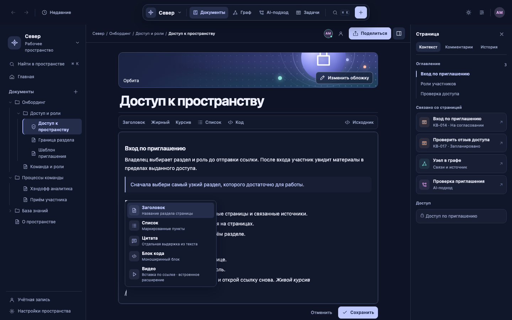
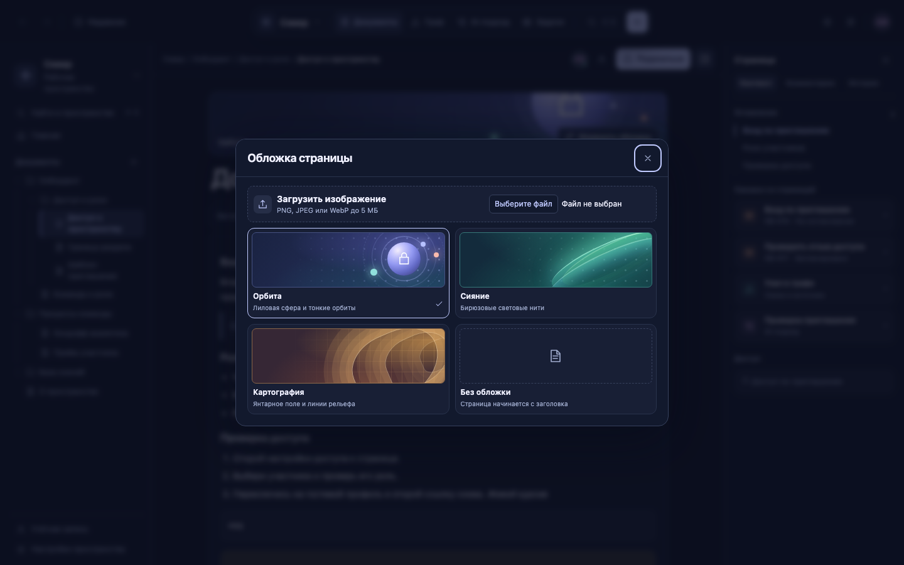

# Документ · Редактор и обложка

[Дизайн рабочего пространства](README.md) · [Компоненты](components.md)

## Читать и редактировать

В режиме чтения заголовок, описание и обложка предшествуют метаданным. Действия «Редактировать» и «Поделиться» появляются в зависимости от доступа. В редактировании показываются поля заголовка, графическая область обложки и форматированный текст. `*текст*` превращается в курсив сразу после завершающей звёздочки. Вся остальная строка и позиция курсора сохраняются. Для работы с исходником предусмотрен отдельный режим. При ошибке сохранения ввод остаётся в редакторе, рядом с повтором указана причина. [KB-MD-01](../../documents/editor/kb-md-01.md) · [KB-MD-02](../../documents/editor/kb-md-02.md) · [KB-MD-05](../../documents/editor/kb-md-05.md)

## Добавить блок

`/` в начале блока или после пробела открывает меню у курсора. Список фильтруется по названию и ключевым словам. Стрелки перемещают выбор, Enter вставляет выбранный блок на место команды, Escape закрывает список с сохранением фокуса и введённого текста. При нехватке места список открывается над строкой и прокручивается внутри доступной области. В кодовом блоке и внутри URL слэш — обычный ввод. Если запрос ничего не нашёл, виден текст «Команды не найдены». [KB-MD-18](../../documents/editor/kb-md-18.md)

Доступные команды зависят от реализованных блоков и настроек пространства. «Блок кода» создаёт блок, рассчитанный на многострочный текст. Видео открывает форму ссылки. Ошибка источника сохраняет значение для исправления. Загрузка внешнего плеера требует действия пользователя, ссылка на источник остаётся доступной. [KB-MD-13](../../documents/editor/kb-md-13.md) · [KB-FIL-06](../../documents/media/kb-fil-06.md) · [Расширения редактора](../../documents/extensions/README.md)

## Выбрать обложку

В редакторе на месте будущей обложки всегда доступно действие «Добавить обложку» или «Изменить обложку». В диалоге есть «Без обложки», выбор готовых тем и загрузка файла. Текущий выбор отмечен иконкой и доступным состоянием. Предел прототипа — 5 МБ, PNG, JPEG или WebP. При ошибке файла остаются предыдущая обложка и изменения текста. Выбор применяется к черновику. Сохранение публикует итог с соответствующей редакцией. В режиме чтения без обложки остаётся обычный заголовок. Пользовательский файл открывается по правам на документ. [Шаблон обложки](../../documents/pages/kb-pag-12.md) · [Своя обложка](../../documents/media/kb-fil-08.md) · [Снять обложку](../../documents/pages/kb-pag-13.md)

