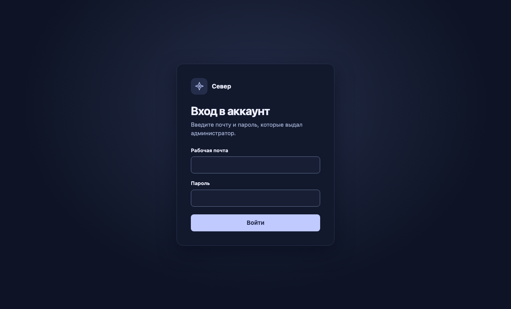
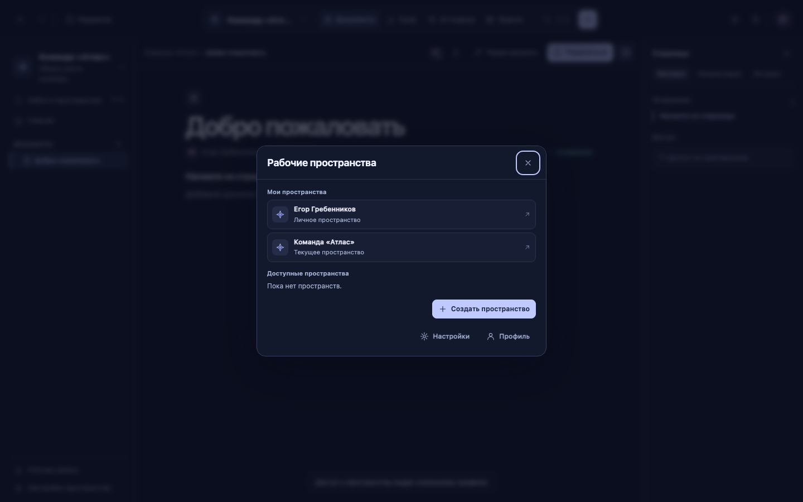
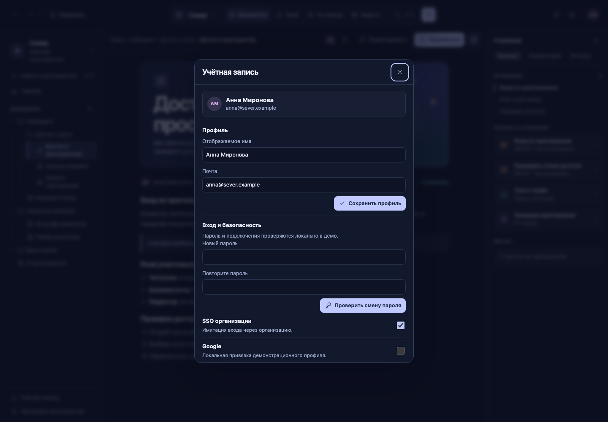

# Онбординг · Аккаунт и пространства

[Дизайн рабочего пространства](README.md) · [Компоненты](components.md)

## Вход

Один центрированный экран «Вход в аккаунт» с брендом «Север». Локальный вход начинается с почты и пароля. Пока запрос выполняется, действие защищено от повторной отправки. При неверной почте или пароле показывается «Неверная почта или пароль». Почта остаётся в поле, пароль очищается. При недоступности сервера видна причина, позволяющая повторить попытку. После входа обновление страницы сохраняет сессию. Для KB-AUTH-01 заранее создаём проверочные аккаунты и открываем закрытый стартовый экран. [KB-AUTH-01](../../documents/access/kb-auth-01.md)

На рабочем экране карточка расширена до 408 px. Поля и основная кнопка имеют высоту от 44 px. При отказе фокус получает сообщение. [Светлая тема и ошибка на узком экране](assets/sever-product-sign-in-mobile-error.png)

При включённой регистрации на экране входа доступно создание учётной записи. Если установка предоставляет SSO, корпоративный вход предлагается здесь же. Первый разрешённый вход создаёт профиль и открывает личное пространство с отображаемым именем, например «Егор Гребенников». Повторный вход возвращает тот же профиль и пространство. [Саморегистрация](../../documents/access/kb-auth-09.md) · [Первый вход через SSO](../../documents/access/kb-auth-15.md) · [Личное пространство](../../documents/spaces/kb-spc-09.md)

## Пространства

Принятый прототип показывает быстрый переход между пространствами из верхнего меню и шапки дерева. Варианты сгруппированы в «Мои пространства» и «Доступные пространства». Действие «Создать пространство» доступно при соответствующем праве. Владелец меняет имя и описание и управляет членством через настройки пространства. [Создание](../../documents/spaces/kb-spc-01.md) · [Шеринг и роли](../../documents/sharing/README.md)

### Каталог пространств

Черновик для отдельного экрана «Пространства». В верхней части — поиск по названию и действие «Создать пространство» для пользователя с правом создания. Под ними — список с названиями, упорядоченный по алфавиту. Название ведёт на постоянный адрес доступного пространства. После открытия пространства пункт «Пространства» возвращает в каталог.

Проверочный сценарий — около 100 пространств и поиск по части названия. Участник открывает пространства, доступные ему для просмотра. Администратор открывает любое пространство своей организации. Предусмотреть состояния загрузки, ошибки с повтором, пустого каталога и поиска без совпадений. На узком экране поиск и кнопка переходят на отдельные строки. [KB-SPC-02](../../documents/spaces/kb-spc-02.md)

### Доступ к пространствам организации

Черновик отдельного экрана для администратора организации. Список группируется по пространствам. В каждой группе видны люди с доступом и их фактические права «Просмотр» и «Редактирование», включая просмотр по роли администратора. Поиск по пространству или человеку помогает найти выдачу среди порядка 100 пространств. [KB-ACL-20](../../documents/sharing/kb-acl-20.md)

## Учётная запись

В «Профиле» отображаются имя и текущая почта. Смена адреса показывает состояние подтверждения. «Вход и безопасность» содержит смену пароля и подключённые способы входа. Для смены пароля повторно проверяется личность. Подключение требует подтверждения у провайдера. При попытке удалить последний доступный способ входа показывается объяснение. Выбор темы расположен среди пользовательских предпочтений. [Вход и учётные записи](../../documents/access/README.md)

