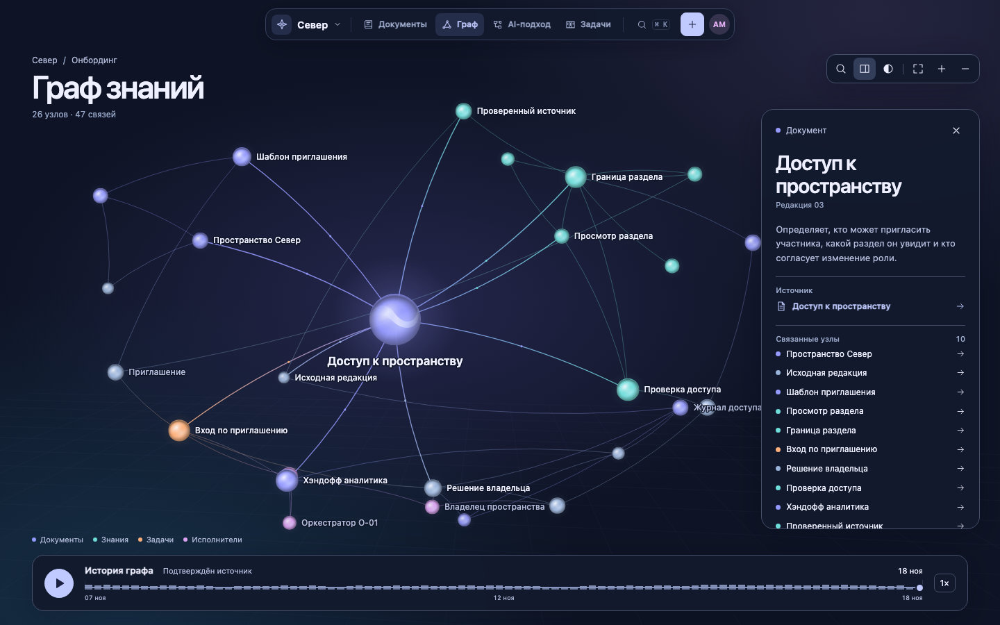
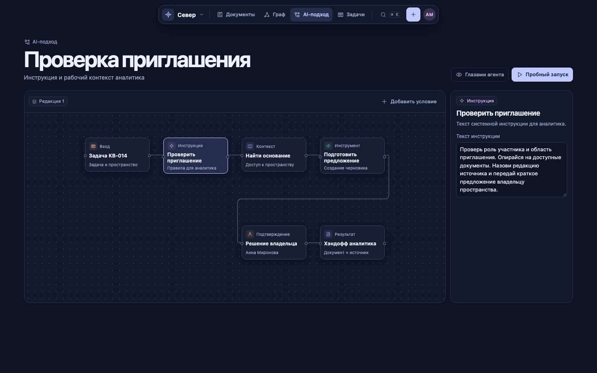
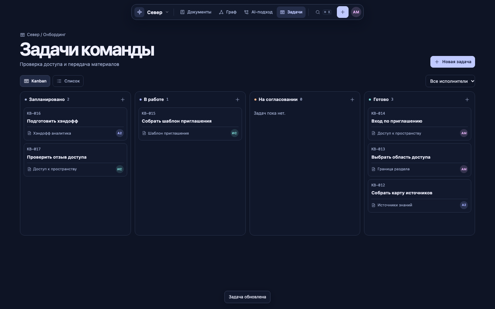

# Север · Граф, AI-подход и задачи

[Дизайн рабочего пространства](README.md) · [Каталог микрофич](../../work-areas/README.md)

## Граф

На холсте выбирают объект через узел или поиск. Инспектор показывает тип, название, редакцию, происхождение и действие перехода к источнику с учётом доступа. Прямая ссылка воспроизводит выбор узла. Лента истории выбирает момент и запускает последовательное появление данных. Пауза сохраняет камеру и момент. При уменьшенном движении остаются дата, ручное перемещение и видимое состояние. [Визуальная основа графа](../../visual-style.md)

## AI-подход

Схема показывает вход, инструкцию, контекст, инструмент, условие, подтверждение и результат. Выбранный блок выделен на схеме и открывает свойства справа. «Глазами агента» показывает версию инструкции, включённые источники и доступные действия для конкретного профиля. Пустой обязательный источник виден до пробного запуска. Журнал макета демонстрирует прохождение шагов. Модель блоков, допустимые связи, результаты исполнения и RAG требуют отдельной проработки. [Рамка AI-подхода](../../ai-approach.md)

## Задачи

Доска показывает задачи текущего пространства по статусам. Колонка содержит название, число задач и пустое состояние. В карточке видны ID, заголовок, исполнитель и доступный источник. Задачу можно открыть для смены статуса, поэтому сценарий доступен и без перетаскивания. Kanban и список используют одни данные. На узком экране сохраняются названия статусов и доступ к карточкам. Фильтр исполнителя действует на оба представления.

