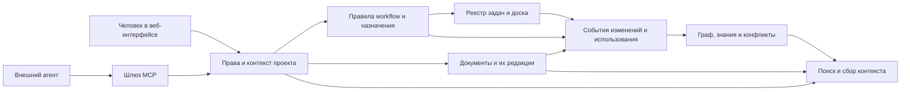

# Карта сервиса и интеграций

Редакция 0.3 от 18 ноября 2026 года. Микросервисная архитектура задана владельцем. Конкретные границы предложены для обсуждения. Границы описывают владельцев данных. Количество исполняемых сервисов, провайдеры, стек, топология развёртывания и эксплуатационные цели будут определены по сценариям и нагрузке. [Концепция продукта](concept.md).

## Границы ответственности

| Область | За какие данные и действия отвечает | Подключение |
|---|---|---|
| Веб и приложения для macOS и Windows | Редактор, пространства, доска, конструктор workflow, граф, история | Используют общий API, показывают доступные модули и состояние операций. Приложения телефона и планшета рассматриваются на следующий этап |
| Идентичность и доступ | Пользователи и агенты, организации, членство, SSO, приглашения, ссылки и политики RBAC/ABAC | Общая основа для доступа к ресурсам и действиям |
| Пространства и документы | Пространства, разделы, дерево, Markdown, редакции, шаблоны и метаданные вложений | Может работать в составе базы документов без доски и агентов |
| Совместная работа и медиа | Сессии редактирования, синхронизация правок, хранение файлов и обработка видео | Расширяет документы. Работа редактора при частичном отключении уточняется |
| Конструктор и исполнение workflow | Черновики и опубликованные версии процессов, шаги, роли, условия, состояния выполнения, назначения, инструкции | Проверяет переходы и действия по правилам опубликованной версии |
| Реестр работы | Фичи, задачи, зависимости, доски, статусы, приоритеты, сроки, исходы и история | Доска показывает состояние работы. Настроенные процессы ограничивают допустимые изменения |
| Шлюз для агентов | Подключение MCP, обнаружение контекста и доступных действий, идентичность вызова, маршрутизация | Вызывает те же операции, что интерфейс и другие клиенты, в рамках прав |
| Граф и редактура знаний | Явные связи, факты, выведенные навыки, хэндоффы, предложения, доверие, происхождение и разрешение конфликтов | Получает сведения об изменениях из документов, задач и процессов. Поддерживает выдачу узлов и истории |
| Поиск и сбор контекста | Поисковые индексы, подготовка фрагментов, выборка, ранжирование и выдача источников | Работает в доступной области. Представляет индексируемую актуальность и запаздывание |
| Каталог расширений | Навыки, плагины, рендереры, подключения, версии и области применения | Состав доступных действий зависит от прав и включённых модулей |
| Управление возможностями | Флаги установки и модулей, версия конфигурации, история изменений | Клиенты получают доступные возможности. Сервисы проверяют флаг и права при выполнении команды |

## Поток одного задания

1. Проект публикует редакцию процесса, а доска создаёт задачу с начальным состоянием и назначает её человеку, агенту или оркестратору.
2. Агент через MCP получает идентификаторы задачи, шага и редакции процесса, инструкцию и разрешённые операции. Это предложение для проверки на первом клиенте MCP.
3. При чтении источника сохраняется событие использования с задачей, шагом и редакцией. При записи документа сервис хранит редакцию и происхождение. Операция связывания закрепляет явную связь с задачей.
4. Запрос перехода проверяет назначение, доступ, текущую редакцию задачи и условия шага. Доска и виджет документа читают один статус реестра. Разрешение на создание документа само по себе не даёт права завершить задачу.
5. Фоновые обработчики обновляют граф и поисковый индекс. В результате следующего поиска видны источники, редакции и происхождение. При отставании индекса доступный исходный документ по-прежнему можно открыть напрямую.

## Контракты, которые предстоит описать

- **Контекст запроса.** Идентичность человека или агента, организация при наличии, пространство, проект, раздел, задача, шаг и цель обращения. При неизвестных связях сервис запрашивает или определяет допустимую область по данным проекта.
- **Артефакты и ссылки.** Стабильный идентификатор, редакция, тип связи, автор и основание. При переименовании ссылка сохраняется. При отзыве доступа виджет, граф и выдача применяют действующий доступ к целевому объекту.
- **Переходы.** Опубликованные правила, ожидаемая редакция работы и допустимый переход. Повтор команды после сетевого сбоя не создаёт повторного артефакта или передачи. Определение процесса и назначение подтверждаются для каждого перехода.
- **Журнал.** У события есть время, исполнитель, область, объект, задача, версия и вид операции. События просмотра и записи, явные ссылки и подтверждённые факты различаются. Политика хранения и объём событий чтения требуют отдельного решения.
- **Поиск и доверие.** Результат содержит короткий ответ или материал, ссылки на доступные источники и нужные редакции. Предложения связей и навыков, подтверждённые факты и конфликтующие версии отражаются разными статусами.
- **Включение модулей.** Система показывает, какие возможности требуют других модулей. Отключение поиска, графа или редакторского расширения сохраняет существующие данные. Правила выполнения уже запущенных workflow при отключении зависящего модуля определяются до поддержки такого переключения.

## Варианты и решения

В первую очередь стоит проверить работу существующего внешнего агента через MCP на одном процессе. Если платформа сама запускает агентов, понадобится отдельная область исполнения заданий, времени работы, отмены, повторов и журналов. Взаимодействие с независимыми агентскими системами можно изучить отдельно при появлении соответствующей интеграции. [Спецификация MCP](https://modelcontextprotocol.io/specification/latest), [обзор A2A](https://a2a-protocol.org/latest/topics/what-is-a2a/).

Документы, реестр и состояния workflow требуют записи в сервисах, которые владеют этими данными. Граф и поисковый индекс можно обновлять в фоне и перестраивать из источников, сохраняя явные связи и принятые решения людей. Это позволяет отдельно масштабировать совместное редактирование, запросы поиска и расчёт визуального графа. Потребуются отслеживание отставания, повтор обработки, сверка версий и проверка прав при выдаче.

Микросервисы поддерживают независимое развёртывание и масштабирование. Они добавляют сетевые отказы, управление совместимостью API и эксплуатацию для самостоятельной установки. Предлагается закрепить границы сразу. Перед реализацией выбрать минимальный набор разворачиваемых компонентов для первого сквозного сценария и выделять новые по требованиям к нагрузке, доступу, владению и жизненному циклу.

Существующий локальный реестр помогает проверить модель задач, двусторонние связи, статусы, согласования, QA и зависимости. Предлагаемый путь интеграции — описать контракт и перенос данных с сохранением идентификаторов, исходов и истории. Текущий JSON и свободное текстовое имя автора принадлежат локальной реализации. Корпоративная версия требует отдельной модели идентичности и доступа. [Локальный реестр](../../feature-center/README.md).

## Как проверить качество

- Права совпадают при чтении документа, поиске, выдаче графа и просмотре карточки. Между проектами результаты не раскрывают закрытые заголовки, связи и свойства. Отозванный доступ учтён при выдаче даже до обновления индекса.
- Параллельное редактирование сохраняет корректную редакцию. Параллельные переходы и повторы не порождают конфликтующие состояния.
- В истории можно ответить, кто или какой агент использовал какую редакцию, по какому заданию, какой результат создал и кто подтвердил основанное на нём знание.
- Первые нагрузочные измерения охватывают задержку совместного редактирования и поиска, свежесть индекса, число одновременных редакторов и агентских задач, объём истории и скорость открытия графа. Численные цели появятся после выбора пилота.

## Передача архитектору

Профили нагрузки, переключение возможностей, схемы C4 и редактируемое представление ArchiMate собраны в [архитектурном эскизе](architecture.md).
