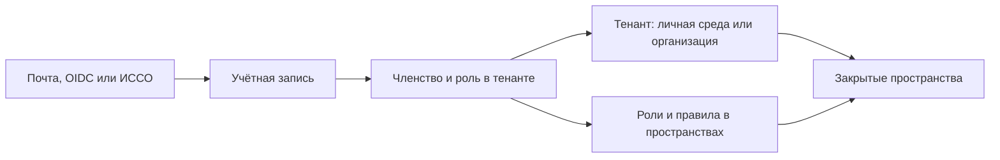

# Тенанты, организации и пространства

Модель и параметры по умолчанию согласованы владельцем в чате Codex 18 ноября 2026 года.

## Одна модель для личной среды и организации

**Тенант** — граница доступа, участников, пространств и настроек. В интерфейсе личная среда называется «Моя среда», корпоративная — по имени организации. Установка может разрешить самостоятельную регистрацию, подключить корпоративный вход или совместить оба сценария. Один и тот же тенант можно переименовать, пригласить в него команду и позднее подключить корпоративный вход с сохранением пространств и ссылок.

**Учётная запись** описывает человека в «Севере». У неё могут быть несколько подтверждённых способов входа и членства в нескольких тенантах. **Членство** связывает учётную запись с конкретным тенантом и определяет её роль в нём. **Пространство** принадлежит ровно одному тенанту. Создатель сразу получает роль владельца пространства. После передачи владения авторство сохраняется, а полномочия получает новый владелец.

## Куда ведёт первый вход

| Сценарий | Что создаётся и куда попадает человек |
|---|---|
| Первый разрешённый вход через ИССО | До входа организация и связь с её провайдером уже настроены. По подтверждённому корпоративному профилю создаются учётная запись при её отсутствии и членство в этой организации. Стартовая роль — «Участник». Открывается организация. |
| Саморегистрация по почте или через обычный OIDC | После подтверждения создаются учётная запись и один личный тенант. Зарегистрировавшийся становится его первым суперадминистратором. Открывается «Моя среда», где он может создать пространство и пригласить коллегу. |
| Приглашение в тенант | Человек входит или регистрируется, подтверждает адрес приглашения и принимает его. Открывается целевой тенант с указанной в приглашении ролью. Существующая личная среда остаётся в переключателе. Новому участнику можно позднее создать свою среду явным действием. |
| Повторный вход | Используются существующие аккаунт и членство. Вход из корпоративной ссылки открывает её организацию. Вход без адреса тенанта возвращает в последнюю доступную среду или показывает выбор. |

ИССО здесь означает корпоративное подключение конкретного тенанта. ИССО и обычный вход через провайдера могут использовать OIDC. Сервер сопоставляет корпоративный вход с организацией по заранее проверенному подключению и правилам допуска, например по назначению приложения или группе каталога. Адрес почты служит для контакта и подтверждения адресного приглашения. Для связи OIDC со стабильным аккаунтом используются `iss` и `sub`. Присоединение нового способа входа к действующему аккаунту требует явного подтверждения. [OpenID Connect Core, § 5.7](https://openid.net/specs/openid-connect-core-1_0.html#ClaimStability)

### Как работает приглашение

Администратор открывает «Участники» в текущем тенанте, вводит адрес и выбирает «Участник». Получатель по ссылке видит имя среды и предложенную роль, входит или регистрируется и подтверждает вступление. Ссылка привязана к адресу и тенанту, действует до указанной даты и может быть отозвана. Повтор успешного принятия открывает уже созданное членство. Ошибка адреса предлагает выбрать нужную учётную запись, а истёкшая ссылка предлагает запросить новую.

Владелец пространства выдаёт доступ действующему участнику своего тенанта через уже показанную панель «Настроить доступ». Для приглашения нового человека в личную среду администратор может указать стартовое пространство и его роль в том же приглашении. После принятия открывается это пространство. Приглашение сотрудника в среду с обязательным ИССО ведёт через корпоративный вход. Суперадминистратор включает внешних гостей отдельной политикой с разрешёнными способами входа и доступом к указанным пространствам.

## Кто чем управляет

| Роль и область | Полномочия |
|---|---|
| Суперадминистратор тенанта | Все административные действия в своём тенанте. Настраивает способы входа и правила подключения, управляет суперадминистраторами и снимает административные роли. У тенанта всегда остаётся хотя бы один действующий суперадминистратор. |
| Администратор тенанта | В своём тенанте управляет участниками и приглашениями, выдаёт право создавать пространства, назначает другого администратора из действующих участников. Имеет просмотр всех пространств своего тенанта. Может настраивать доступ к ним согласно предложению для макета. |
| Участник тенанта | Видит пространства, на которые у него есть право. Создаёт пространства при назначенном праве. Создание сразу даёт владение созданным пространством. |
| Владелец пространства | Управляет содержимым и назначает роли в своём пространстве. При передаче владения выбирает действующего участника того же тенанта. |
| Читатель и редактор пространства | Читатель просматривает разрешённые материалы. Редактор выполняет действия, включённые в матрице конкретного пространства. Роль выдаётся человеку или группе, либо применяется по правилу на атрибутах членства. |

Администратор назначает другого администратора отдельным действием уже после вступления человека. Повышение требует повторного подтверждения входа и фиксируется в журнале. Назначение суперадминистратора и снятие административной роли выполняет суперадминистратор. Административное право просмотра закрытых пространств действует внутри своего тенанта. Редактирование их содержимого требует разрешения на уровне пространства. Оператор установки обеспечивает запуск и восстановление. Доступ к содержимому у него возникает через членство или отдельную согласованную процедуру восстановления.

## Что увидит пользователь

- В шапке имя текущей среды показано отдельно слева, например «Север» или «Моя среда». Справа расположен переключатель пространств этой среды. При смене среды через меню тенантов или принятии приглашения открывается её каталог. Самостоятельная и корпоративная среды используют одинаковую оболочку. [Макет каталога](design/handoff/spaces-and-account.md#каталог-пространств)
- В текущей среде раздел «Пространства» показывает доступный каталог. «Создать пространство» появляется у того, кому выдано право. Владельцу в шапке пространства доступно «Настроить доступ».
- Настройки среды содержат «Участники», «Приглашения», «Право создания» и «Доступ к пространствам». Подключение ИССО и управление суперадминистраторами находятся в настройках защищённого уровня текущей среды. При переходе в другую среду каталог, поиск и административные экраны используют её права.

## Границы доступа и жизненный цикл

- Сервер на каждый запрос определяет текущую учётную запись, действующее членство, разрешённый способ входа для тенанта и право на действие. Корпоративная среда с обязательным ИССО требует корпоративного подтверждения, даже если та же учётная запись вошла в личную среду через почту. Пространство, группы и назначения проверяются в пределах текущего тенанта.
- Поиск, файлы и запросы AI-агентов применяют те же границы, что каталог. Атрибуты для правил доступа поступают из доверенного каталога или назначаются администрацией тенанта. Изменение своего имени или личной почты сохраняет текущие права.
- При исключении или блокировке участника сервер прекращает доступ к соответствующему тенанту, сохраняет историю авторства, а доступ в остальные среды продолжает работать. Заблокированное членство сохраняет статус при повторном ИССО, пока уполномоченный администратор или политика провижининга явно его не восстановят. Для синхронизации отключения сотрудников и групп можно позднее подключить SCIM. [SCIM, RFC 7643](https://www.rfc-editor.org/rfc/rfc7643.html#section-4.1.1) · [SCIM, RFC 7644](https://www.rfc-editor.org/rfc/rfc7644.html)
- Если бывший сотрудник владел пространством, материалы остаются в тенанте. Администратор передаёт владение другому действующему участнику. Исключение сотрудника и передача владения могут выполняться раздельно.
- Создание личного тенанта с первым суперадминистратором, первое корпоративное членство и принятие приглашения устойчивы к повтору и параллельным запросам. История фиксирует добавление и отзыв ролей, изменение настроек входа и передачу владения.
- При подключении обязательного ИССО суперадминистратор сначала проверяет рабочий корпоративный вход и способ восстановления доступа. Первого суперадминистратора корпоративного тенанта назначают при настройке установки или создании тенанта.

## Проверочные сценарии

1. Мария регистрируется по почте, получает личную среду и приглашает Алексея. Алексей принимает инвайт и открывает среду Марии со своей ролью. Регистрация без приглашения у Елены сразу открывает её собственную среду.
2. Ирина входит через ИССО организации. Повторный вход возвращает её прежнее членство. Администратор этой организации назначает Ирину администратором. В её личной среде действуют собственные роли.
3. Мария создаёт закрытое пространство у себя и становится владельцем. Администратор другой организации получает в своей среде только свой каталог. Человек с двумя членствами может переключаться между ними.
4. Участник без права создания открывает выданное ему пространство, а выдача права открывает действие «Создать пространство». Отзыв права сохраняет его владение существующим пространством.
5. Организация приостанавливает членство сотрудника. Его запросы к организации прекращаются, включая запросы по сохранённой ссылке. Повторная авторизация через ИССО сохраняет приостановку. Его личная среда остаётся доступной через разрешённый способ входа.
6. Пользователь принимает приглашение дважды, сотрудник одновременно завершает два первых входа через ИССО. В каждом случае в целевом тенанте остаётся одно членство.

## Место в текущей поставке

Текущее рабочее приложение уже хранит локальные аккаунты и сессии. Для первого среза [KB-SPC-01](documents/spaces/kb-spc-01.md) достаточно тестового тенанта с предвыданными членствами и правами. Создание пространства сохраняет связь с этим тенантом и владельцем. При вводе тенантов существующие аккаунты сохраняют идентификаторы и получают членство по явной настройке установки.

Дальнейшие проверяемые результаты можно поставлять независимо после появления границы тенанта.

1. Саморегистрация создаёт личную среду с первым суперадминистратором. [KB-AUTH-09](documents/access/kb-auth-09.md) · [KB-SPC-09](documents/spaces/kb-spc-09.md)
2. Адресное приглашение добавляет участника в тенант. Выдача роли в отдельном пространстве остаётся связанной историей. [KB-ACL-01](documents/sharing/kb-acl-01.md)
3. Администратор назначает другого администратора и выдаёт право создания. Обзор доступа показывает основания внутри текущей среды. [KB-AUTH-17](documents/access/kb-auth-17.md) · [KB-ACL-20](documents/sharing/kb-acl-20.md)
4. Корпоративное подключение связывается с выбранным тенантом, первый вход автоматически добавляет разрешённого сотрудника, отключение закрывает членство. [KB-AUTH-06](documents/access/kb-auth-06.md) · [KB-AUTH-15](documents/access/kb-auth-15.md) · [KB-AUTH-16](documents/access/kb-auth-16.md) · [KB-AUTH-05](documents/access/kb-auth-05.md)

Новый человек, пришедший по приглашению, сначала получает членство в целевой среде и может создать свою отдельно. Внешние приглашения в корпоративную организацию включаются суперадминистратором по необходимости.
