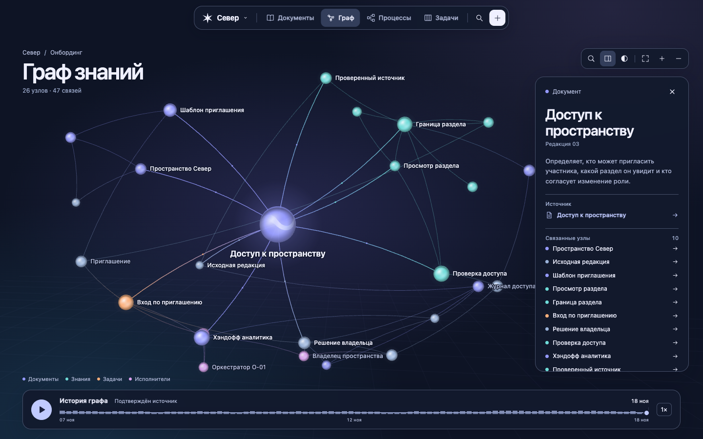
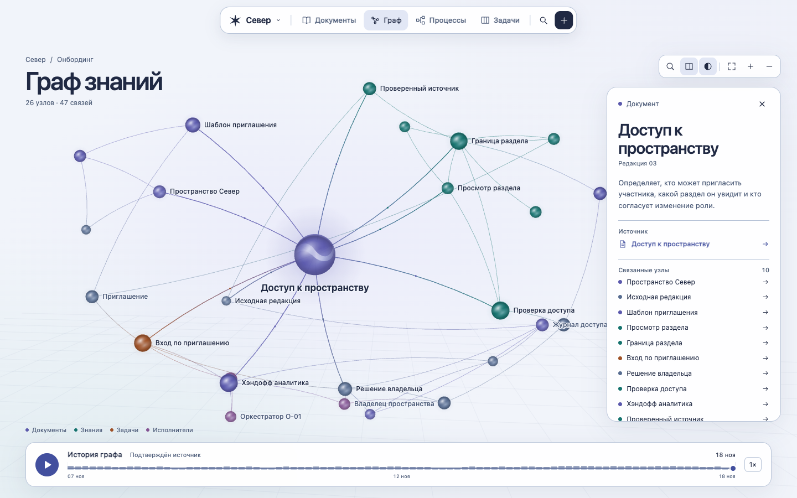

# Визуальная основа продукта

**Визуальная основа началась с экрана графа.** Владелец выбрал его тёмную палитру, компактное верхнее меню и контекстную панель справа. Эти решения развиты в утверждённом прототипе. Точные токены, сценарии и состояния для реализации ведутся в [дизайне рабочего пространства](design/handoff/README.md) и [библиотеке компонентов](design/handoff/components.md).

Сравнивать темы лучше на одном узле «Доступ к пространству». Переключатель в панели графа сохраняет выбор узла, положение камеры и момент истории. [Тёмный граф](http://127.0.0.1:4120/design/?theme=dark#atlas/graph/access) · [Светлый граф](http://127.0.0.1:4120/design/?theme=light#atlas/graph/access).

## Верхнее меню

Одна плавающая панель по центру окна. Слева — пространство и его меню, в центре — документы, граф, процессы и задачи, справа — поиск и создание. Активная область выделена заливкой и отмечена для экранного диктора. Переключение предметной области сохраняет привычное расположение команд.

Для широкого окна ориентир макета — отступ 12 px сверху, скругление 17 px, тонкая граница и мягкая тень. Ширину определяют команды. На узком экране сохраняются названия областей, поиск и создание. При работе с клавиатурой фокус виден поверх холста, панели и диалога.

## Когда открывается правая панель

| Экран | Повод открыть | Что показать | Когда вернуть место |
|---|---|---|---|
| Граф | Выбран узел или открыта прямая ссылка | Тип, название, происхождение, редакция, связанные узлы и переход к источнику | По кнопке закрытия. Камера и выбор сохраняются |
| Документ | Читатель открыл контекст страницы | Оглавление, связанные задачи и факты, доступ. Слева остаётся дерево пространства | При чтении без контекста или редактировании на узком экране |
| Конструктор | Пользователь выбрал шаг или переход и открыл свойства | Роль, вход, выход и условие перехода для выбранного элемента | При работе с компоновкой холста или по команде закрытия |
| Реестр | Открыта конкретная задача | Исполнитель, статус, источник, следующее допустимое действие | После возврата к очереди. Позиция строки и фильтр сохраняются |

Эталон графа использует ширину инспектора 230–315 px. Прокручивается его содержимое. При ширине окна до 760 px сведения открываются по запросу поверх холста. Для будущих экранов это критерий приёмки макета: основная работа должна оставаться доступной после открытия и закрытия панели.

## Палитры

| Роль | Тёмная тема | Светлая тема | Применение |
|---|---|---|---|
| Фон рабочей области | `#0E1425` | `#F1F4FA` | Пространство вокруг данных |
| Поверхность | `#12192D` | `#FFFFFF` | Инспектор, меню, поиск и панель истории |
| Основной текст | `#EFF0FF` | `#202943` | Названия, основной текст, выбранный объект |
| Вторичный текст | `#B2BBDA` | `#4C5B78` | Подписи, происхождение, автор и дата |
| Акцент действия | `#C0CAFF` | `#424F9E` | Основное действие и выделение |
| Документ | `#959AFF` | `#5B59AD` | Страница, редакция, шаблон |
| Знание | `#6FDDD9` | `#15736E` | Факт, навык, проверенный источник |
| Задача | `#FDB07B` | `#9F5227` | Рабочий элемент |
| Исполнитель | `#E0A4F4` | `#845392` | Человек или агент |
| Служебная запись | `#9AB3DA` | `#586D91` | Решение или событие |

Светлая тема использует холодный почти белый холст и белые панели. На нём у линий, подписей и типов объектов свои тёмные оттенки. Основной и вторичный текст на сплошной поверхности дают соответственно контраст 15,4:1 и 9,2:1 в тёмной теме, 14,4:1 и 6,8:1 в светлой. Прозрачные поверхности, подписи поверх линий и состояние фокуса дополнительно проверяются на самом экране.

## Узлы и движение

Визуальный ориентир для узла — мягкая светящаяся сфера с неоднородным светом внутри. Объём передают градиент, глубина сцены и движение камеры. Выбор заметен по размеру, свечению, названию и карточке. Тип подписан в инспекторе. Это позволяет читать граф также по тексту.

Во время Play внимание остаётся на появлении данных: сначала возникает узел, затем вырастает связь. Пауза останавливает историю в выбранном месте. В режиме уменьшенного движения сохраняются наблюдаемые состояния, дата и ручное управление.

## Что передавать дизайнеру

Для следующей фичи достаточно одного сквозного сценария в двух темах. Показать заполненный экран, отсутствие выбора, открытый и закрытый инспектор, переход к источнику и узкое окно. Загрузку, ошибку и отсутствие прав показывать там, где они меняют действие пользователя. Для документов первым проверяется маршрут «раздел → страница → связанная задача».
